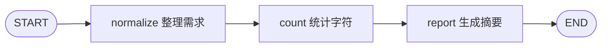

# 第 1 天 最小 LangGraph 示例

学习目标：用普通 Python 函数跑通一张图，能解释 State、Node、Edge，以及一次请求如何经过节点并得到结果。运行过程不调用模型、不需要 API Key。

## 文件与运行方式

| 文件 | 用途 |
| --- | --- |
| `__init__.py` | 将 `day01` 定义为独立 Python 包 |
| `demo.py` | 状态定义、三个节点、构图逻辑和命令行入口 |
| `test_demo.py` | 状态传递与执行行为的自动验证 |

先按照项目根目录 README 安装依赖，以下命令均在 `langgraph-demo` 根目录运行。

```bash
# 一次执行完整张图，打印最终状态和摘要。
python -m day01.demo

# 打印输入状态以及每个节点完成后的完整状态。
python -m day01.demo --steps

# 换一份输入，观察空白整理和字符数变化。
python -m day01.demo --steps --requirement "  ABC   DEF  "

# 运行当天的验证用例。
python -m unittest day01.test_demo -v
```

也可以在 PyCharm 中直接运行 `day01/demo.py`，使用已安装依赖的 Python 解释器；需要观察过程时，在运行配置的 Parameters 中填入 `--steps`。

## 图的执行流程



`START` 和 `END` 是起止标记。真正执行逻辑的是中间三个节点，每个节点都是接收状态、返回更新字段的普通函数。

## 三个核心概念

| 概念 | 本例对应代码 | 如何理解 |
| --- | --- | --- |
| State | `RequirementState` | 节点之间共享的数据结构，保存输入与中间结果 |
| Node | `normalize_requirement`、`count_characters`、`generate_report` | 读取状态并计算更新的 Python 函数 |
| Edge | `builder.add_edge(...)` | 规定节点之间的执行顺序 |

`StateGraph(RequirementState)` 声明状态结构；`add_node` 注册节点；`add_edge` 连接节点；`compile()` 生成可执行图；`invoke()` 执行整张图；`stream()` 允许逐步观察执行结果。

`TypedDict` 用来描述字段类型，不负责运行时校验。`total=False` 允许字段逐步补齐，但 `requirement` 仍是本例必需的初始输入；空白文本会被主动拒绝。

## 观察状态如何更新

以 `--requirement "  ABC   DEF  "` 为例：

| 阶段 | 本阶段新增或更新的字段 | 完整状态中的字段 |
| --- | --- | --- |
| 输入 | `requirement = "  ABC   DEF  "` | `requirement` |
| normalize 完成 | `normalized_requirement = "ABC DEF"` | 原始输入、整理后的需求 |
| count 完成 | `character_count = 7` | 原始输入、整理后的需求、字符数 |
| report 完成 | `report = "需求摘要..."` | 前三个字段和最终摘要 |

节点只返回自己更新的字段。例如 `count_characters` 返回 `{"character_count": 7}`，原始需求仍会保留。框架将节点返回的字段合并回状态；本例没有配置 reducer，同一字段被后续节点更新时，新值会覆盖旧值。

`--steps` 使用 `stream_mode="values"`，因此看到的是完整状态快照。这个线性图共有四个快照：输入一次、三个节点完成后各一次。

最后打印的摘要内容为：

```text
需求摘要
需求内容：ABC DEF
字符数量：7（包含空格）
处理方式：普通 Python 函数与固定模板
```

这是字符统计与模板摘要，语义分析将在接入模型后学习。本例没有配置持久化，同一张图的两次独立调用不会自动保留上一轮数据。

## 建议学习顺序

1. 用约 10 分钟阅读状态定义和流程图，先预测执行顺序。
2. 用 20～30 分钟分别运行普通模式、`--steps` 和自定义输入。
3. 用 20～40 分钟按 `main → build_graph → 三个节点` 的顺序阅读代码，在节点中打断点观察 `state`。
4. 用 10～20 分钟运行验证用例，完成以下练习并记录观察结果。

## 自己动手验证

- 将输入改为中文、多行文本或带有连续空格的文本，先预测整理结果与字符数，再运行验证。
- 将输入改为纯空格，确认程序给出需求不能为空的提示。
- 在 count 和 report 之间添加一个普通函数节点，为状态增加 `category = "学习练习"` 字段，并将其显示在摘要中。
- 画出图的执行流程，说明为什么 report 节点能读到前两个节点的结果。

## 完成标准

- 能独立运行示例，且当天四个自动验证用例全部通过。
- 能指出 State、Node、Edge 分别在代码中的什么位置。
- 能解释输入与每个节点输出之间的关系，以及状态字段如何逐步补齐。
- 能新增一个节点并正确连接边，让新字段出现在最终状态中。
