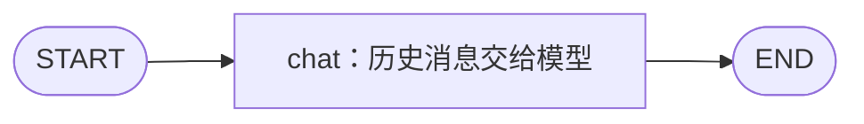

# 第 2 天 接入模型与连续对话

学习目标：接入聊天模型，用 `MessagesState` 保存对话消息，观察两轮对话后状态如何从 2 条消息增长到 4 条。每天投入 1～2 小时。

## 文件与流程

| 文件 | 用途 |
| --- | --- |
| `demo.py` | 模型配置、聊天节点、会话状态与命令行入口 |
| `test_demo.py` | 验证历史传递、会话隔离、失败处理和消息合并 |
| `__init__.py` | 定义独立的 `day02` Python 包 |
| 根目录 `.env.example` | 真实模型配置模板，不包含实际密钥 |



每轮运行同一张图。`ChatSession` 在图外保存上一轮的完整结果；下一轮把历史与新用户消息一起传给 `invoke()`。

## 先离线验证

以下命令在 `langgraph-demo` 根目录执行，使用项目自己的 Python 3.12 环境。

```bash
uv pip install --python .venv/bin/python -r requirements.txt

# 默认自动发送两条消息，并在每轮结束后打印状态。
.venv/bin/python -m day02.demo --offline --steps

# 自定义连续输入；每个 --message 代表一轮对话。
.venv/bin/python -m day02.demo --offline --steps \
  --message "项目代号是小星" \
  --message "刚才说的代号是什么？"

# 自动验证，不访问模型服务，也不需要 API Key。
.venv/bin/python -m unittest day02.test_demo -v
```

离线模式只回显传入的历史和当前输入，用于验证消息传递，没有模型推理能力。第二轮的“此前用户输入”应包含第一轮的项目描述。要验证助手能否理解并回答记忆问题，继续运行真实模型模式。

`--steps` 表示每轮结束后打印完整消息状态；本例每轮只有一个 `chat` 节点，不会额外调用一次模型。

## 接入火山方舟模型

默认模型为 `deepseek-v4-1-flash-261017`，接口地址为 `https://ark.cn-beijing.volces.com/api/v3`。通过 `ChatOpenAI` 调用其 OpenAI 兼容接口，超时时间为 1800 秒。

```bash
cp .env.example .env
# 在编辑器中填写 .env 中的密钥与模型 ID。

.venv/bin/python -m day02.demo --steps

# 自由输入消息，连续交流。
.venv/bin/python -m day02.demo --interactive --steps
```

| 配置项 | 含义 |
| --- | --- |
| `ARK_API_KEY` | 火山方舟密钥，必填；也兼容 `OPENAI_API_KEY`，前者优先 |
| `OPENAI_MODEL` | 可选，默认 `deepseek-v4-1-flash-261017` |
| `OPENAI_BASE_URL` | 可选，默认火山方舟北京区 `/api/v3` 地址 |
| `MODEL_THINKING` | `disabled`（默认）或 `enabled`，控制思考模式 |

`.env` 从项目根目录加载，已有同名环境变量优先。不要将真实密钥写进代码；`.env` 已加入 Git 忽略规则。思考模式通过 `extra_body={"thinking": {"type": thinking}}` 传入；示例打印最终回复正文。

真实模型运行时，第一轮告诉助手“项目代号是小星，输出前必须人工审核”，第二轮询问项目代号与关键要求。检查回答是否同时包含这两点。模型答案可能变化，消息传递通过自动用例独立验证。

如果遇到 `UnicodeEncodeError`，先检查 `ARK_API_KEY`（或备用 `OPENAI_API_KEY`）是否仍是中文占位文字，以及 `OPENAI_ORG_ID`、`OPENAI_PROJECT_ID` 是否含中文或空白。请求头通常要求 ASCII 字符，中文聊天正文可以正常发送。程序会在启动时检查这些配置，提示字段名但不显示配置值。终端或 PyCharm 中已有的同名环境变量优先于 `.env`，修改后需重启程序。

交互模式中输入 `/clear` 清空当前历史，输入 `/exit` 退出。PyCharm 可直接运行 `day02/demo.py`，解释器选择本项目 `.venv/bin/python`，Parameters 填 `--offline --steps` 或 `--interactive --steps`。

## 与第 1 天相比，状态发生了什么变化

第 1 天使用自定义 `TypedDict`，普通字段默认被新值覆盖。第 2 天使用 `MessagesState`，其 `messages` 字段自带 `add_messages` reducer，合并规则是：新 ID 的消息追加，已有 ID 的消息更新。

| 时刻 | 完整消息状态 |
| --- | --- |
| 第 1 轮输入 | `HumanMessage(需求描述)` |
| 第 1 轮结束 | `HumanMessage(需求描述), AIMessage(回复1)` |
| 第 2 轮输入 | 前两条消息，加 `HumanMessage(追问)` |
| 第 2 轮结束 | 前三条消息，加 `AIMessage(回复2)` |

节点只返回 `{"messages": [response]}`，框架将这条回复合并进输入状态。传给模型的消息另外包含一条 `SystemMessage`，用于约束助手行为；它不写入会话状态，所以打印的状态中没有这条系统提示。

注意区分两个动作：`add_messages` 负责一次图执行中的消息合并；`ChatSession` 负责在两次图执行之间保存并传回历史。仅复用同一个 graph、每轮只发送新消息，不会自动记住过去的对话。

本例历史只保存在当前进程中，新建会话、清空历史或重启程序都会丢失。SQLite checkpoint 与 `thread_id` 将在第 4 天接入。真实模型调用失败时，本轮用户消息和回复都不写入历史，可重新输入后重试。

## 学习与验证顺序

1. 约 10 分钟：回顾第 1 天，画出今天只有一个节点的执行图。
2. 约 20 分钟：运行离线模式，确认两轮后消息数量为 4，顺序为 human、ai、human、ai。
3. 约 30 分钟：配置真实模型，告诉助手代号和审核要求，再追问；清空后重新提问，对比结果。
4. 约 20～40 分钟：按 `main → ChatSession.send → chat` 阅读代码、打断点，运行验证用例。

练习：暂时把 `send()` 的输入改为只传本轮 `HumanMessage`，观察第二轮是否还能记住代号，再恢复代码。沿相邻源码项目的 `libs/langgraph/langgraph/graph/message.py` 阅读 `MessagesState` 与 `add_messages`。

完成标准：能运行真实模型连续对话，解释为何第二轮能读取第一轮内容；能说明 `MessagesState` 的消息合并与图外历史保存各自负责什么；当天 8 个验证用例全部通过。
