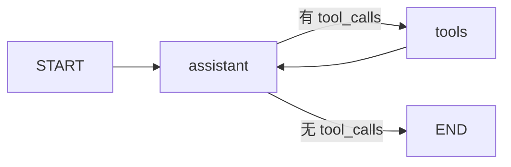

# 第 3 天 自定义工具与条件分支

目标：让需求分析助手在需要项目资料时调用工具，其他问题直接回答。



在项目根目录运行：

```bash
.venv/bin/python -m day03.demo --offline --steps
.venv/bin/python -m unittest day03.test_demo -v
```

默认发送两轮消息。第一轮要求查审核资料，消息顺序应为 `human → ai(工具请求) → tool(资料结果) → ai(最终回答)`。第二轮是问候，直接得到 `human → ai`，不会调用工具。`--offline` 使用固定规则模拟模型选择，仅用于观察图的执行，不具备语义判断能力。

接入真实模型时，沿用第 2 天项目根目录 `.env` 的配置：

```bash
.venv/bin/python -m day03.demo --steps
.venv/bin/python -m day03.demo --interactive --steps
```

真实模式通过 `create_model().bind_tools([lookup_requirement_note])` 告诉模型工具的名称和参数格式。模型可能返回带 `tool_calls` 的 `AIMessage`，但不会亲自执行 Python 函数。`tools_condition` 检查最新消息：有工具请求就去 `ToolNode` 执行 `lookup_requirement_note`，否则结束。工具结果以 `ToolMessage` 加入状态，再回到 `assistant` 生成最终回复。真实模型是否调用工具由模型决定，答案也可能变化。

`lookup_requirement_note` 只查询代码中的两条固定资料：人工审核要求和项目代号。查不到时明确返回未找到。系统提示仅在模型调用时附加，不写入会话状态。`ChatSession` 沿用第 2 天的图外历史保存方式；第 4 天才接入持久化。

练习：在固定资料里增加一条约束，分别用离线与真实模式查询；在 `tools_condition` 和 `lookup_requirement_note` 处打断点，比较工具分支与直接回答分支经过的节点。
