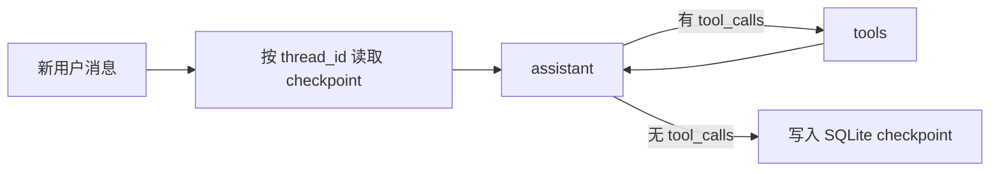

# 第 4 天 SQLite checkpoint 与会话恢复

目标：理解 `thread_id` 如何把一次图调用与磁盘中的会话状态关联起来。第 3 天的工具分支保持不变，第 4 天给编译后的图接入 `SqliteSaver`。

在 **`langgraph-demo` 项目根目录**运行，先安装新增依赖：

```bash
uv pip install --python .venv/bin/python -r requirements.txt
```

分两次运行下面的命令。第二条命令是新进程，但沿用同一 SQLite 文件和 `thread_id`，启动时应显示 4 条已保存消息，发送问候后增长到 6 条。

```bash
.venv/bin/python -m day04.demo --offline --steps --thread-id project-a \
  --message "请查资料，输出报告前有什么审核要求？"
.venv/bin/python -m day04.demo --offline --steps --thread-id project-a \
  --message "你好"
```

换一个 ID 验证隔离：

```bash
.venv/bin/python -m day04.demo --offline --steps --thread-id project-b --message "你好"
.venv/bin/python -m unittest day04.test_demo -v
```

默认数据库为 `day04/checkpoints.sqlite`，可用 `--db /path/to/other.sqlite` 指定其他文件；默认 `thread_id` 为 `demo`。反复运行相同命令会继续增加消息，要从空状态开始可换新的 ID 或新的数据库路径。交互模式使用 `--interactive`。真实模型模式去掉 `--offline`，沿用根目录 `.env` 配置，会产生 API 调用。



`graph.invoke({"messages": [HumanMessage(...)]}, config={"configurable": {"thread_id": ...}})` 每轮只发送新消息。编译图时传入的 `checkpointer` 负责读取同一 `thread_id` 的旧状态，`MessagesState` 再将新消息追加到历史。`graph.get_state(config)` 用来查看该线程最新 checkpoint。这里不再用第 2、3 天的 `ChatSession` 手工回传全部历史，否则会混淆图外保存与 checkpoint 恢复两种方式。

本例只演示同步、单进程顺序调用。工具执行前暂停和恢复将在第 5 天加入。
