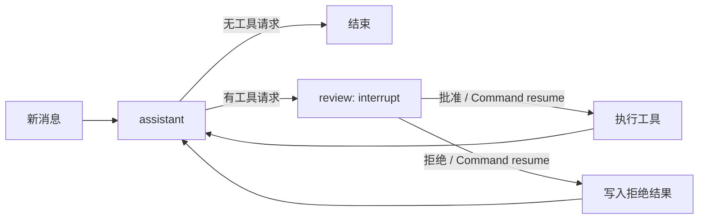

# 第 5 天 人工确认与中断恢复

目标：在执行查询工具前暂停，由人决定是否允许执行；退出程序后，仍能用 SQLite checkpoint 恢复同一次调用。

在 `langgraph-demo` 项目根目录运行。先提交一个需要查资料的问题：

```bash
.venv/bin/python -m day05.demo --offline --steps --thread-id review-a \
  --message "请查资料，输出报告前有什么审核要求？"
```

程序停在 `review`，此时消息状态只有用户消息和 AI 工具请求，工具尚未执行。另起一个进程，用相同的数据库路径和 `thread_id` 批准：

```bash
.venv/bin/python -m day05.demo --offline --steps --thread-id review-a --resume approve
```

若要观察拒绝，换一个 `thread_id` 提交问题，然后运行 `--resume reject`。拒绝后不会调用查询工具，图会写入一条说明拒绝原因的工具消息，再给出取消答复。普通问候无需确认，会直接结束。也可以用 `--interactive` 在同一进程内确认；输入 `/exit` 后仍可用 `--resume` 恢复。

默认数据库是 `day05/checkpoints.sqlite`。可用 `--db /path/to/other.sqlite` 指定路径；恢复时必须保持数据库路径和 `thread_id` 一致。测试命令：

```bash
.venv/bin/python -m unittest day05.test_demo -v
```



`interrupt()` 使 `review` 节点暂停，`SqliteSaver` 把待运行节点与消息状态保存到 SQLite。恢复时 `Command(resume=True/False)` 把人工决定交还给这个节点；`review` 会从头执行，因此中断之前不要放不可重复的外部写入。`graph.get_state(config).next` 可查看是否仍待确认。工具获批后才执行；拒绝时用与原工具调用 ID 对应的 `ToolMessage` 补齐消息历史。
